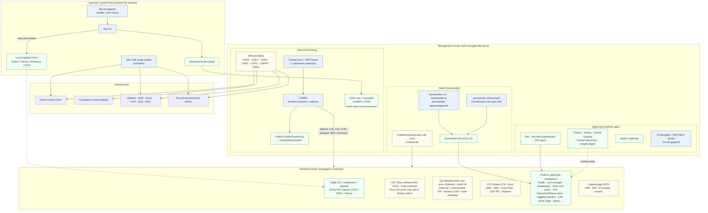
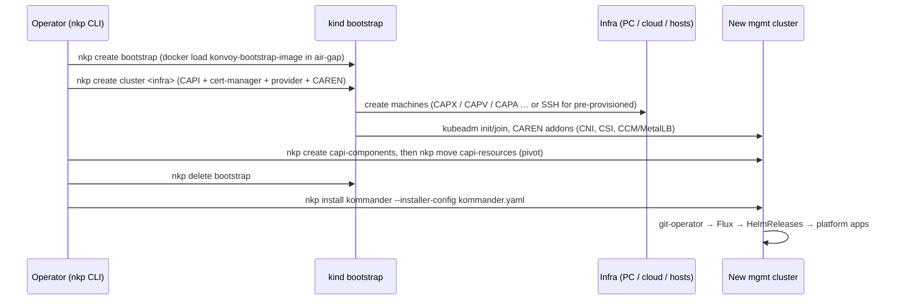

# Nutanix Kubernetes Platform (NKP) 2.19 — component map

This map is the input for the NKP skills. It shows all NKP components, their layers, and how they connect.
The detailed evidence for each component is in `research/raw/0N-*.md`. Each row here points to that file.

**Source tags:** `[live]` = read-only observation of a live NKP 2.19.0 cluster and bundle (`research/raw/live/2.19/`, index in `SUMMARY.md`). `[pdf p.N]` = NKP 2.19 PDF. `[web]` = public web source (see the raw file for the URL). `[field]` = field notes (vault or `everything-nkp`). This map uses the source priority live > PDF > web > field. The live cluster is AHV with a **Starter** license, so Pro and Ultimate apps were seen only as catalog entries.

**Raw files:** `01` lifecycle (Konvoy) · `02` networking and security · `03` Kommander, apps, and GitOps · `04` observability, storage, and GPU · `05` air-gap, upgrade, and troubleshooting · `06` Flow CNI · `07` NDK 2.3 · `08` NKP in a Flow VPC (TN-2207) · `live/2.19/` lab facts · `portal/` portal page lists. `[portal: <title>]` = a page on portal.nutanix.com (read as a guest with a browser).

---

## 1. What NKP is

- NKP is the Nutanix commercial Kubernetes platform. Nutanix bought the D2iQ Kubernetes Platform (DKP) in 2024 and has shipped it as NKP since **2.12**. NKP replaces Nutanix NKE. [web]
- NKP has **three product parts** [pdf p.20]:
  - **Konvoy**: cluster lifecycle (Cluster API, ClusterClass, CAREN, CNI, CSI, cluster autoscaler, cert-manager, load balancers).
  - **Kommander**: fleet and application management (Flux-based platform apps, workspaces, projects, RBAC, catalogs, the NKP UI).
  - **NIB** (Nutanix Image Builder, which was KIB before): builds the node OS images and the OS package bundles.
- There is **one CLI** (`nkp`). `nkp version` shows its sub-tools: `catalog, diagnose, imagebuilder, kommander, konvoy, konvoybundlepusher, mindthegap`. [pdf p.1013]
- There are **3 license tiers** (licensed by core). You cannot downgrade a license tier after registration. [pdf p.26-28]

| Tier | Scope |
|---|---|
| **Starter** | AHV only, one provider, a Rocky image only. Includes the basic security and ingress apps. No monitoring and no logging. |
| **Pro** | One infrastructure provider, multi-cluster with the same provider. Adds observability, logging, Harbor, Velero, Istio, GPU, Headlamp, and AI Navigator. |
| **Ultimate** | Multiple providers, attaching external clusters, EKS and AKS lifecycle, Projects, multi-tenant logging, central monitoring (Thanos, Karma, central Grafana), OpenCost, and Insights. |

The default key is **Starter on AHV** and **Pro on other infrastructure**. [pdf p.28]

---

## 2. Layered architecture

Colour key: blue = Nutanix-owned · green = upstream CNCF/OSS · orange = a mix or a choice of providers.

### How a cluster is built

`--self-managed` runs the pivot steps for you. [pdf p.22-23, p.667]

### How an app is delivered

`AppDeployment` (workspace ns) → `ClusterApp` (platform) | `App` (catalog) → Flux `Kustomization` → `HelmRelease` → `HelmChart` → the workload cluster. The source is the internal git repo (git-operator), ChartMuseum (only in air-gap), or an `OCIRepository` (catalogs). [pdf p.271, p.1059, p.1068-1070]

---

## 3. Layer tables

Columns: **Where** = B bootstrap · M management · W workload · N node OS · O operator host. **By** = how the component is deployed. **Tier** = S/P/U (Starter/Pro/Ultimate). **AG** = the air-gap note.

### 3.1 Lifecycle layer (Konvoy) — raw `01`

| Component | Upstream | NKP name / namespace | Where | By | Default | AG |
|---|---|---|---|---|---|---|
| `nkp` CLI | Nutanix | `nkp` | O | manual | required | in the bundle as `./cli/nkp`. The CLI version must match the target NKP version. |
| Bootstrap cluster | kind | `konvoy-bootstrap-image-<ver>.tar` | O | `nkp create bootstrap` | required | `docker load` the image first. |
| Cluster API core v1.12.11 | kubernetes-sigs/cluster-api | `capi-system` | B→M | `nkp create capi-components` | on | images in `konvoy-image-bundle`. |
| CAPI operator v0.26.0 + **CAPI stack operator** v0.6.29 | kubernetes-sigs/cluster-api-operator + Nutanix | `capi-stacks.nkp.nutanix.com`, provider CRs | M | Kommander (OCIRepository charts) | on | CAPI, the providers, and CAREN are installed as one stack through these operators. The providers are CRs, not static manifests. [live] |
| kubeadm bootstrap + control plane | CAPI CABPK/KCP | `capi-kubeadm-*-system` | B→M | CAPI | on | `--kubernetes-image-repository`. FIPS images use the `+fips.0` tag. |
| cert-manager (for CAPI) | cert-manager | installed with CAPI | B→M | `capi-components` | on | — |
| **CAREN** | nutanix-cloud-native/cluster-api-runtime-extensions-nutanix | Deployment `cluster-api-runtime-extensions-nutanix`, ns `caren-system` | B→M | `capi-components` | on | registry mirror and credentials are CAREN variables. |
| ClusterClass + **NKPCluster** | CAPI + Nutanix | `clusters.nkp.nutanix.com/v1alpha1`. Classes `nkp-nutanix-v2.19.0`, `nkp-aws-v2.19.0`, `nkp-eks-v2.19.0`, `nkp-host-agent-v2.19.0` (pattern `nkp-<infra>-v<ver>`), each in the namespaces `kommander`, `kommander-default-workspace`, and `default`. Each class has only 2 variables: `clusterConfig` and `workerConfig`. Worker class `default-worker`. [live] | M | `nkp upgrade kommander` | AHV, Metal, EKS = ClusterClass. AWS/Azure/GCP/vSphere/pre-prov = non-ClusterClass. | — |
| UpgradePlan | Nutanix | `upgradeplans.upgrade.nkp.nutanix.com` + `upgrade-plan-controller-manager` | M | Kommander | on | the declarative object behind UI upgrades. GitOps upgrades do not make one. [live][pdf p.1035] |
| **CAPX** v1.10.15 (Nutanix AHV) | nutanix-cloud-native/cluster-api-provider-nutanix | `capx-system` | M | CAPI | AHV default | `--bundle` **xor** `--registry-mirror-*`, plus `--airgapped`. |
| **CAPV** (vSphere) | kubernetes-sigs/cluster-api-provider-vsphere | `capv-system` | M | CAPI | P/U | vSphere template built with NIB. |
| CAPA (AWS) / EKS | kubernetes-sigs/cluster-api-provider-aws | `capa-system` | M | CAPI | P/U. EKS = U only, k8s ≥1.34, ClusterClass only. | AWS: bundle AMI, bastion in the VPC. |
| CAPZ (Azure) / AKS | kubernetes-sigs/cluster-api-provider-azure | `capz-system` | M | CAPI | P/U. AKS = U only. | Compute Gallery image. |
| CAPG (GCP) | kubernetes-sigs/cluster-api-provider-gcp | `capg-system` | M | CAPI | P/U | GCP image. |
| CAPPP (pre-provisioned) | Nutanix (Konvoy) | `cappp-system`, `PreprovisionedInventory` | M | CAPI over SSH | P/U | `nkp upload image-artifacts` to the hosts. |
| **NKP Metal** (new in 2.19) | Nutanix | `HostAgentMachineTemplate`, `NutanixBareMetalMachineTemplate`, class `host-agent-worker`. Provider `cluster-api-provider-host-agent` v0.9.4, API group `hostagent.nutanix.com` (`hosts`, `assignedhosts`, `hostselectorpolicies`). [live] | M + hosts | Foundation Central imaging + host agent + bootstrap token | P/U | Ubuntu 24.04 ISO only, no FIPS. Stage the ISO and the images. |
| CAAPH v0.6.2 | kubernetes-sigs/cluster-api-addon-provider-helm | `caaph-system`, `HelmChartProxy` (name `<addon>-<cluster-uid>`) | M | CAPI | on | CAREN addon charts come from an **in-cluster OCI registry** `oci://helm-repository.caren-system.svc/charts` (mindthegap `serve bundle`, mTLS). This is how addons work in air-gap. [live] |
| ClusterResourceSet | CAPI | per-cluster CRS | M | CAPI | non-ClusterClass addons | CRS custom changes are **lost** on upgrade. |
| Cluster Autoscaler | kubernetes/autoscaler | annotations `cluster-api-autoscaler-node-group-min/max-size` | W | CAREN / CRS | optional | — |
| **kube-vip** 1.1.1 | kube-vip | control-plane VIP | W (CP) | CAPI create flow / CAREN virtual-IP provider `KubeVIP` | AHV: the `--control-plane-endpoint-ip` VIP [pdf p.722][web]. Pre-prov: optional (`--virtual-ip-interface`). | add the VIP to `noProxy`. kube-vip moves the VIP. It is not a load balancer. |
| etcd 3.6.8 | etcd | static pods under KCP | W (CP) | kubeadm | on | `registry.k8s.io/etcd:3.6.8-0` [live]. Encryption at rest is on by default (`secretbox`). [live] |
| Node OS + containerd | — | Rocky 9.8, Ubuntu 22.04/24.04, RHEL 8.10/9.6/9.8, Flatcar, OL | N | NIB image | — | cgroups v2 and x86_64 only. The OS packages are **not** in the bundle (use `nkp create package-bundle`). |
| **NIB / KIB** | Nutanix | `nkp create image`, `nkp create package-bundle` | O | CLI (container) | required for non-AHV infrastructure | `docker load nkp-image-builder-image-<ver>.tar`. The 2.19 bundle has **no** `nib/` or `kib/` folder. [live]. Bake the images in with `--bundle`. |
| konnector-agent | Nutanix | CAREN addon `konnectorAgent` | W | CAREN | on (`--onboard-to-prism-central=false` turns it off) | registers the cluster in Prism Central. If the pod stays in Init, enable `karbon-core` in PC. Not the same as Kubetunnel (see 3.2). [pdf p.507, p.725] |
| Node Feature Discovery (NFD) | kubernetes-sigs/node-feature-discovery | CAREN addon `nfd`, ns `node-feature-discovery` | W | CAREN / CRS | on | labels nodes. The GPU operators use the labels. Upgraded with the core addons. [pdf p.1025-1027] |
| Prism Central dependency | Nutanix | PC credentials Secret per cluster; `nutanix-ccm-credentials` (`kube-system`) | M + W (AHV) | create flags | required on AHV | CAPX (VMs, subnets), Nutanix CSI (volumes), and Nutanix CCM (node metadata) all call the PC API. If you rotate the PC credentials, update the CAPX, CCM, and CSI Secrets. PC 7.5/7.6 [web]. [pdf p.705, p.725-726] |
| NKP Insights | Nutanix | `nkp-insights-management` (M), `nkp-insights` (W) | M + W | platform app | U. Mgmt part is on, engine is opt-in. | separate insights bundle. The Trivy DB is fixed at build time. |
| AI Navigator + NKP MCP Server | Nutanix (Azure OpenAI) | `ai-navigator-app`, RAG, MCP | M | platform app | P/U when connected | **not supported in air-gap**. |
| Pulse | Nutanix | `nkp-pulse-management/workspace` | M + W | internal app | opt-in | needs `insights.nutanix.com:443`. Keep it off in air-gap. |

### 3.2 Networking, ingress, security, and identity — raw `02`

| Component | Upstream | NKP name / namespace | Where | By | Default | Notes |
|---|---|---|---|---|---|---|
| **Cilium** 1.19.4 | cilium/cilium | CAREN `addons.cni.provider: Cilium`, `kube-system` | M + W | CAREN (HelmAddon) | **default on AHV and EKS** | kube-proxy is replaced. Geneve tunnel, `loadBalancer.mode: dsr`. Set custom values **at create time** with a ConfigMap and `values.sourceRef`. [pdf p.593, p.727] |
| Hubble relay | cilium | app `cilium-hubble-relay-traefik` | M + W | platform app (internal) | relay on, UI off | relay is exposed through Traefik with TLS passthrough. |
| **Calico** | projectcalico (Tigera operator) | `addons.cni.provider: Calico`, `calico-system` | M + W | CAREN / CRS | **default on all other providers** | kube-proxy stays. IP-in-IP or VXLAN. 2.19 version is UNKNOWN (not on the live AHV cluster). |
| **Nutanix Flow CNI** (1.1.0+) | Nutanix, on OVN-Kubernetes (OVN + OVS, Geneve). Chart `nutanix-flow-cni` | ns `flow-cni-system`, `flow-cns-system`, `ovn-kubernetes`. CRs `EgressIP`, `EgressService` (`k8s.ovn.org/v1`) | M + W (**AHV only**) | (A) **documented**: `nkp create cluster nutanix --dry-run -o yaml` → delete `addons.cni` → append a CAAPH `HelmChartProxy` for `nutanix-flow-cni` → create. (B) **schema**: `addons.cni.provider: Flow` (the AHV ClusterClass enum is `Calico, Cilium, Flow`; the EKS, AWS, and host-agent classes allow only Calico and Cilium). [portal][live] | opt-in, never the default. There is no CLI flag. | Documented **only in the Flow Virtual Networking Guide 7.6**, not in the NKP guide. Supports only NKP-created clusters. Needs NKP ≥2.18 with **Rocky Linux nodes** (use the pre-built Rocky Linux 9.8 image [pdf p.55]; the lab cluster is Ubuntu), AOS 7.6+, AHV 11.2+, **pc.7.6+**, Network Controller 7.6.0+ in integrated mode, VLAN Basic node subnets, Konnector on. Maps namespaces to Nutanix VPCs (Shared Services VPC, container-only, hybrid VM+pod, transit). Flow CNI does not give LB IPs, so MetalLB stays. Images are in private `docker.io/nutanix` (token from the Downloads portal). Air-gap: push the `flow-cni-<ver>` dark-site bundle into Harbor or the mirror. Raw `06`. |
| **NKP in a Flow VPC** (TN-2207) | Nutanix Flow Virtual Networking | the node VMs sit on a VPC **overlay** subnet. Flags `--control-plane-endpoint-ip` (a private VIP inside the VPC), `--control-plane-external-endpoint` (floating IP or FQDN; goes into the API cert), `--cluster-hostname` (UI through a floating IP) | M + W (AHV) | Prism Central objects (VPC, external subnet NAT/no-NAT, overlay subnet, floating IPs) + `nkp create cluster nutanix` | optional topology | Needs NKP 2.17+, AOS/PC 7.5+, Network Controller 7.0.0+. The CNI stays Cilium. kube-vip and MetalLB work in the overlay, and floating IPs map them out (one floating IP per LB IP). The bastion must be **inside** the VPC (a floating IP cannot be the VIP). MTU 1442: set Docker and kind to 1442 before the bootstrap. Pod and service CIDRs must not overlap any VPC range. PC 9440 and the registry 443 must be reachable from the overlay. Topologies: isolated, exposed, mixed, transit VPC. Using a VPC for the nodes **and** Flow CNI together is not supported (Flow CNI needs VLAN Basic node subnets). Cilium DSR on an overlay: UNKNOWN. Raw `08`. [portal][live] |
| ClusterMesh | cilium | — | — | — | not an NKP feature | field values only. There is a known ECDSA cert bug in 1.17.4. [field] |
| kube-proxy | kubernetes | `kube-system` | W | kubeadm | Calico clusters only | not present on Cilium clusters. |
| CoreDNS | coredns | `kube-system` | W | kubeadm | on | NodeLocal DNS is not shipped. |
| **Nutanix CCM** 0.8.12 | nutanix-cloud-native/cloud-provider-nutanix | `HelmChartProxy nkp-cloud-provider-nutanix-<c>` | W (AHV) | CAREN | on (AHV) | node metadata discovery only [pdf p.726]. It does **not** give `LoadBalancer` IPs (MetalLB does). |
| **MetalLB** 0.15.x | metallb | `metallb-system`, CAREN `serviceLoadBalancer.provider: MetalLB` | W | CAREN addon | AHV, pre-prov, and vSphere | AHV: the pool comes from `--kubernetes-service-load-balancer-ip-range` [pdf p.693-694][field]. Pre-prov and vSphere: you must create the `IPAddressPool` + `L2Advertisement`/BGP yourself. **Do not edit the default pool** (it stalls upgrades). The first IP is the `kommander-traefik` IP. |
| Gateway API CRDs | kubernetes-sigs/gateway-api | `gateway-api-crds` | M + W | platform app (internal) | on, all tiers | CRDs only. |
| **Traefik** (chart 39.0.7) | traefik | `traefik`, class `kommander-traefik`, svc `kommander/kommander-traefik` | M + W | platform app (foundational) | on, all tiers | the only ingress. An external LB must **not** terminate TLS. |
| Traefik Forward Auth | mesosphere/traefik-forward-auth | `traefik-forward-auth` (W), `-mgmt` (M) | M + W | platform app | on | 4 KB cookie limit → HTTP 500 → set `clusterStorage.enabled`. |
| **cert-manager** 1.20.3 | cert-manager | `cert-manager`, CA `kommander-ca` (10 years) | M + W | platform app | on, all tiers | the ACME issuer must be named `kommander-acme-issuer`. ACME does not work in air-gap. |
| external-dns | kubernetes-sigs/external-dns | `external-dns` | M + W | platform app | optional, P/U | needs an internal DNS provider in air-gap. |
| **Dex** (2.42 runs; PDF says 2.22, which is stale) | dexidp/dex | `dex`, overrides in ConfigMap `kommander/dex-overrides` | M | platform app | on | LDAP, AD, SAML, OIDC connectors. In air-gap the IdP must be internal. |
| dex-k8s-authenticator | mintel | `dex-k8s-authenticator` | M | platform app | on | generates kubeconfigs. |
| kube-oidc-proxy | jetstack | `kube-oidc-proxy` | M + W | platform app | on, all tiers | lets `kubectl` use Dex tokens. |
| RBAC model | Kommander + k8s | `KommanderWorkspaceRole`, `VirtualGroup`, `sync-to-project` annotation | M → W (federated) | Kommander + KubeFed | on | subject names: `oidc:<group>` or `oidc:<ws-id>:<group>`. |
| **Gatekeeper** 3.23.0 | open-policy-agent/gatekeeper | `gatekeeper` (+ `gatekeeper-proxy-mutations`) | M + W | platform app | **on** | the default constraints enforce project tenancy [pdf p.581]. On the live mgmt cluster: one ConstraintTemplate `requiredserviceaccountname` with the constraints `helmrelease-must-have-sa` and `kustomization-must-have-sa`. [live]. **Kyverno is not shipped** (none on the live cluster). The gatekeeper-library files are not in the bundle. |
| Istio (`istio-helm`) | istio | `istio-helm-system`, `istio-helm-gateway-ns` | M + W | platform app | optional, P/U | sidecar or ambient mode. The Istio operator was removed in 2.17. Kiali, Jaeger, and Knative need overrides. |
| Kubetunnel | Nutanix | `kubetunnel`, `TunnelConnector` | M + W | platform app (internal) | on | attaches clusters that have network restrictions. |
| Multus v4.2.4 | k8snetworkplumbingwg | DaemonSet `kube-system/multus` | N | node roll (2.18+) | installed, idle | not documented. [web] |
| External Secrets | external-secrets | `external-secrets` | M (always since 2.17) + W | platform app | mgmt: always on | NKP uses it to push registry credentials and certificates to clusters. |
| Reloader | stakater/Reloader | `reloader` | M + W | platform app (foundational) | on | — |
| **Headlamp** 0.45.0 | kubernetes-sigs/headlamp | `headlamp` | M + W | platform app | **P/U only**: on for fresh Pro or Ultimate 2.19 installs, off after an upgrade. Not available on Starter (live annotation `licensing: pro,ultimate,…`). [pdf p.313][live] | replaces Kubernetes Dashboard (which is deprecated but still listed). |
| FIPS 140-3 | — | `+fips.0` images from `docker.io/mesosphere`, `nkp check cluster fips` | N + W | create-time flags | off. P/U, custom RHEL images only. | you cannot change FIPS after the cluster is created. |
| CIS | — | prebuilt images: CIS L1 for the OS, L2 for k8s | N | NIB | prebuilt images | for L2 hardening, patch the `KubeadmControlPlaneTemplate`. [field] |

### 3.3 Fleet, platform apps, and GitOps (Kommander) — raw `03`

| Component | NKP name / namespace | Where | Notes |
|---|---|---|---|
| Kommander controller | `kommander-cm`, ns `kommander` | M | manages workspaces, projects, and KommanderClusters. |
| Kommander UI | `kommander-ui` → `https://<host>/nkp/kommander/dashboard` | M | Global / Workspace / Project views. |
| App manager | `kommander-appmanagement` (`apps.kommander.d2iq.io/v1alpha3`) | M | AppDeployment / ClusterApp / App. |
| Flux | `kommander-flux` (source, kustomize, helm controllers) | M + W | foundational app (with Reloader and Traefik). [pdf p.299] |
| git-operator | `git-operator-system` | M | the internal git repo that is the source of truth for Kommander. |
| ChartMuseum | in `kommander-flux` | M | **air-gap only**. |
| kommander-applications | `apps-kommander` Kustomization | M | definitions of the platform apps. Uses `${helmMirrorURL}`. |
| KubeFed | `kube-federation-system` | M | **deprecated in 2.18 but still runs in 2.19**. Insights-mgmt needs it. |
| Workspace | `workspaces.kommander.mesosphere.io` | M | group of clusters. You cannot move a cluster between workspaces. `kommander-workspace` is reserved for the management cluster. |
| Project | `Project` CRD, federated namespace | M → W | U only. Project CD uses `GitopsRepository`. |
| KommanderCluster | `kommander.mesosphere.io/v1beta1` | M | label `kommander.d2iq.io/cluster-name` is what `clusterSelector` matches. |
| **NKPCluster** | `clusters.nkp.nutanix.com/v1alpha1` | M | owns the CAPI `Cluster` + `KommanderCluster`. A **webhook blocks direct edits of `Cluster.spec.topology`**. |
| Platform apps | ClusterApp `<id>-<ver>` | M + W | installed **as one bundle per workspace**. You cannot upgrade one app alone. |
| Catalog apps | `App` + `OCIRepository` | M + W | **2.19: OCI only (GitRepository catalogs removed)** [web]. Live: 23 `OCIRepository` objects, zero `HelmRepository`, and one `GitRepository` (`kommander-flux/management`, the internal git-operator repo). `nkp upgrade kommander --allow-gitrepository-catalog-apps` exists as an override. [live] The 2.19 upgrade checks for "deprecated GitRepository-based catalog apps" [pdf p.1017]. Some PDF pages (p.348, p.357) still show GitRepository steps: that text is stale. Tools: `nkp create catalog-bundle`, `nkp push bundle`, `nkp create catalog-collection` / `catalog-application`. |
| Nutanix product catalog | `nkp-nutanix-product-catalog` (NDK, NAI) | M + W | air-gap tar `nutanix-product-catalog-<ver>-airgapped.tar` (Nutanix infrastructure only). |
| Harbor | `harbor`, ns `ncr-system`, port 5000 | M | optional, P/U. Needs CloudNativePG + S3 (COSI, Nutanix Objects, or Rook Ceph). |
| CloudNativePG | `cloudnative-pg` | M + W | P/U platform app. PostgreSQL operator. Harbor, AI Navigator, NKP Insights, and NAI need it. The 2.19 upgrade checks that it is on. [pdf p.1017] |
| PriorityClasses | live names: `dkp-high-priority` (100001000), `dkp-critical-priority` (100002000) [live]. The PDF says `nkp-*` [pdf p.315-316]. | M + W | NKP sets them on platform apps. Override with the chart `priorityClassName` value in the AppDeployment config. Use the names that `kubectl get priorityclass` shows. |
| Other Kommander controllers | ns `kommander`: `kommander-operator`, `nkp-cluster-controller-manager` (+ webhook), `nkp-management-plane-controller-manager`, `release-controller-manager`, `loggingstack-controller-manager`, `kommander-capimate`, `kommander-flux-operator`, `cluster-observer`, `runtime-extension-kommander`. ns `kommander-flux`: `flux-oci-mirror` (mirrors Flux OCI artifacts). | M | [live] |
| Glue charts (internal) | `cilium-hubble-relay-traefik`, `karma-traefik`, `prometheus-thanos-traefik`, `kommander-cert-federation` | M + W | small charts that expose an internal service through Traefik with a federated certificate. [live] |
| ClusterApp annotations | `apps.kommander.d2iq.io/{licensing,scope,type,dependencies,certifications,category}` | M | the source of truth for the tier, scope, and dependencies of each app: `kubectl get clusterapp <name> -o yaml`. [live] |

#### Platform apps by license tier (PDF Table 22, p.295-297, read with table extraction → `research/raw/pdf/2.19/platform-apps-table.tsv`)

`M`/`W` = management / workload cluster. ✔ = supported.

| App | Starter M/W | Pro M/W | Ultimate M/W |
|---|---|---|---|
| cert-manager, Flux, Gatekeeper, Gateway API CRDs, kube-oidc-proxy, Reloader, Traefik | ✔/✔ | ✔/✔ | ✔/✔ |
| Dex, dex-k8s-authenticator, Git Operator, TFA-mgmt, Pulse-mgmt | ✔/– | ✔/– | ✔/– |
| External Secrets, TFA, Pulse-workspace | –/✔ | –/✔ | –/✔ |
| AI Navigator (App, Cluster Info Agent, RAG), Harbor | – | ✔/– | ✔/– |
| Cilium Hubble Relay Traefik, CloudNativePG, COSI Driver Nutanix, ExternalDNS, Fluent Bit, Grafana Logging, Grafana Loki, Istio Helm, Jaeger, Kiali, Knative, Kube Prometheus Stack, Kubernetes Dashboard, Kubetunnel, Logging Operator, NVIDIA GPU Operator, AMD GPU Operator, AMD KMM Operator, Prometheus Adapter, Rook Ceph, Rook Ceph Cluster, Velero, vGPU Token Operator | – | ✔/✔ | ✔/✔ |
| Centralized Grafana, Karma, NKP Insights Management, Thanos | – | – | ✔/– |
| OpenCost, NKP Insights, Project Grafana Logging, Project Grafana Loki, Project Logging | – | – | ✔/✔ |

These apps are not in Table 22 but exist in 2.19: `headlamp` (P/U), `kommander`, `kommander-ui`, `kommander-appmanagement`, `kubefed`, `centralized-opencost` (U). [pdf p.313, p.699-703, p.960]
The **Kubecost** app is removed (replaced by OpenCost in 2.17).

### 3.4 Observability, storage, backup, and GPU/AI — raw `04`

| Component | NKP app / namespace | Where | Default | Notes |
|---|---|---|---|---|
| **kube-prometheus-stack** (82.13.6) | `kube-prometheus-stack` → Prometheus Operator, Prometheus, Alertmanager, node-exporter, kube-state-metrics, Grafana | M + W | on (P/U) | a user `ServiceMonitor` needs the label `prometheus.kommander.d2iq.io/select: "true"`. To change the Alertmanager config, replace its Secret. `/dkp/grafana` |
| prometheus-adapter | `prometheus-adapter` | M + W | on | custom metrics for HPA. |
| **Thanos** | `thanos` (Query) + sidecars | M | U | remote query only. It does not back up metrics. |
| **Karma** | `karma` | M | U | alert dashboard for all clusters. You cannot silence alerts in it. |
| Central Grafana | `centralized-grafana` | M | U | dashboard label `grafana_dashboard_kommander: "1"`. |
| OpenCost | `opencost`, `centralized-opencost` | M + W | U | use custom pricing in air-gap. |
| **Logging Operator** 6.4.0 | `logging-operator` (kube-logging: Fluent Bit DaemonSet + Fluentd) | M + W | on in the mgmt installer defaults, **off for managed and attached clusters** (enable per workspace) [pdf p.547, p.960] | CRDs `Logging`, `Flow`, `ClusterFlow`, `Output`, `ClusterOutput`. External forwarding (Splunk, Elastic, syslog) = a generic `ClusterOutput`. [field] |
| Fluent Bit (admin and audit logs) | `fluent-bit` 0.57.2 | W | off on mgmt | writes directly to Loki and costs about 2 GB per node per day. |
| **Grafana Loki** | `grafana-loki-v3` 3.6.7 | M + W | per workspace | 1-week retention. Index is boltdb-shipper (move to TSDB with a new schema period). Storage = Rook Ceph S3 by default. |
| Grafana Logging | `grafana-logging` 11.3.3 | M + W | with Loki | — |
| Multi-tenant logging | `project-logging`, `project-grafana-loki-v3`, `project-grafana-logging` | W | U, optional | needs workspace logging first. |
| **Rook Ceph** | `rook-ceph` 1.19.5, `rook-ceph-cluster` 1.19.6, `dkp-object-store` | M + W | on | **only for** Loki, Velero, OpenCost, Insights, and Harbor. PVC mode, 4×40 GiB, EC 3+1 ≈ 120 GiB usable. Change it **only with an AppDeployment override**. |
| COSI | `cosi-driver-nutanix` (`cosi-nutanix-nkp`, `cosi-ceph-nkp`) | M + W | with Insights and Harbor | does not accept a custom CA. |
| **Nutanix CSI** 3.9.0 | CAREN addon, ns `ntnx-system`, SC `nutanix-volume` | W (AHV) | on | Volumes, Files, and AOS multi-writer RWX (new in 2.19). StorageClass parameters cannot be changed after creation. |
| local-static-provisioner 2.8.0 | SC `localvolumeprovisioner` | W (pre-prov) | default SC | not for production. |
| Cloud CSIs | EBS 1.62 · Azure Disk 1.34.4 · GCP PD 1.15.4 · vSphere 3.4.0 | W | per provider | `allowVolumeExpansion: false` by default. |
| Snapshot controller | external-snapshotter | W | with the CSI | Velero uses CSI snapshots only if you enable them. |
| **Velero** | `velero`, **workspace namespace** (`kommander` on the mgmt cluster, the workspace ns on other clusters) | M + W | P/U | daily backup `velero-default` with no volume snapshots. Default storage = Ceph `dkp-velero`. Use `velero … -n ${WORKSPACE_NAMESPACE}`. [pdf p.510-511] |
| **NDK 2.3** | catalog app `ndk`, ns `ntnx-system` (reserved: never put apps or protection CRs there). Controllers `ndk-controller-manager`, infra manager, job scheduler. Optional `ndk-ui`. CLI `ndkcli` (a kubectl plugin is possible). CRDs `dataservices.nutanix.com` + `scheduler.nutanix.com` (StorageCluster, Application, ApplicationSnapshot(Restore), Remote, ReplicationTarget, JobScheduler, ProtectionPlan, AppProtectionPlan, failover CRs) | M + W (AHV) | optional. P/U/NKPFS. One instance per cluster. | needs CSI ≥3.7.1 (UI ≥3.8), AOS/PC 7.5+, `iscsi-initiator-utils`, a PE data-services VIP, one MetalLB IP for `ndk-intercom-service` (port 2021; the NDK UI page names 347 as the default remote-site port — open both until verified). The StorageClass and container names must be the same on both sites. Replication: **async** (recipes, max 15 snapshots on the target), **sync** (one PC + witness, PE ports 2030/2036/2073/2090/8740), **NearSync** (newest state only), **3DC**. Air-gap: `nkp create catalog-bundle --airgapped --apps=ndk=<v>` (needs Docker Hub, run it outside) → `nkp push bundle --to-registry ...` (the PDF's `--to-registry-mirror-*` flags do not exist [live]) → `nkp create catalog-application`, or the guide's Helm path with the portal bundle. Raw `07`. |
| Nutanix Objects (BYOS) | external S3 | outside | optional, recommended | for Velero, Loki, and Insights. The DNS name and the CA must work inside the cluster. |
| Kasten K10 | custom catalog app | W | not shipped | [field]. The old GitRepository catalog format does not work in 2.19. |
| **NVIDIA GPU Operator** | `nvidia-gpu-operator` (`ClusterPolicy`) | W | optional, P/U | driver 580.x, precompiled drivers recommended. **DRA is on by default in 2.19.** MIG works only with passthrough. Time-slicing uses a ConfigMap. |
| vGPU Token Operator | `vgpu-token-operator` | W | optional | needs a delegated license server in air-gap. |
| AMD GPU / KMM operators | `amd-gpu-operator`, `amd-kmm-operator` | W | optional | MI350 is validated. |
| AI Catalog | KAI Scheduler, Slurm Operator, Kueue, Kubeflow Pipelines, JupyterHub, Milvus Operator | W | P/U, optional | enable the GPU operator before the scheduler. |
| NAI 2.8.x | catalog app, `nai-system` + `envoy-gateway-system` | M + W | optional | needs KServe 0.19, Envoy GW 1.8.2, OTel 0.114.1, LWS 0.8.0, CNPG, and a Files StorageClass. Its air-gap bundle is separate. |

### 3.5 Air-gap, registry, upgrades, and troubleshooting — raw `05`

| Item | Facts |
|---|---|
| **Air-gapped bundle** | Real 2.19.0 bundle `nkp-bundle_v2.19.0_linux_amd64.tar.gz` (about 37 GB) → `nkp-v2.19.0/`: `NOTICES`, `cli/nkp`, `kubectl`, `konvoy-bootstrap-image-v2.19.0.tar`, `nkp-image-builder-image-v2.19.0.tar`, `nkp-ubuntu-24.04-release-amd64.iso` (+ `.sha256`, `.metadata.json`, for NKP Metal), `container-images/{kommander-image-bundle, konvoy-image-bundle, kubernetes-os-ubuntu-24.04-nkp-v2.19.0-v1.36.2_linux_amd64, nkp-ai-applications-catalog-image-bundle-2.19, nkp-nutanix-product-catalog-image-bundle-2.19, nkp-release-specs-v2.19.0}.tar`, `image-artifacts/` (`containerd-2.3.1-d2iq.1-<os>-x86_64[_fips].tar.gz` for each OS, `images/kubernetes-images-1.36.2-d2iq.1[-fips].tar`). **No** `nib/`, `kib/`, `application-charts/`, or `application-repositories/` (charts are OCI now). **The OS distro packages are not included.** [live]. The PDF layout (p.770, p.997) is stale. |
| Registry modes | (a) **local mirror** `--registry-mirror-url/-cacert/-username/-password`, or (b) **internal registry mirror** `--bundle …` / `nkp push bundle --to-internal-registry-mirror`. **Never use both** in one create. [pdf p.725]. `--registry-url/-username/-password/-cacert` is different: it gives credentials for an upstream registry (for example Docker Hub pull limits). It is not a mirror mode. `--airgapped=true` is a separate flag (it controls UI and app behaviour). |
| Bundle tools | `nkp create bundle` **exists** (mindthegap: `--images-file`, `--helm-charts-file`, `--oci-artifacts-file`, `--output-file`, `--platform`). Also `nkp serve` (serve a bundle as a registry), `nkp import` (load a bundle into containerd), `nkp push image-archive`. [live] |
| Seeding | `nkp push bundle --bundle <tars> --to-registry=<url> [--to-registry-ca-cert-file]`. Seeding is optional since 2.16 if the internal mirror is used. Harbor shows a "project not found: mesosphere" error, which is a false positive. Supported registries: Artifactory >7.11, Nexus, Harbor ≥2.1.1, ECR. |
| Node plumbing | containerd `certs.d` / `hosts.toml` mirrors + `dynamic-credential-provider`. Registry changes reach only **new** machines → force a rollout with `rolloutAfter`. [field] |
| OS packages | build them **outside** the air gap with `nkp create package-bundle <os> --artifacts-directory`. Then use `nkp create image … --artifacts-directory` or `nkp upload image-artifacts` (pre-prov). |
| Kommander in air-gap | `nkp install kommander --init --airgapped > kommander.yaml` → edit → install. AI Navigator is not installed. ChartMuseum is installed. Pre-prov: set a Rook Ceph host-device override. |
| HTTP/S proxy | `--http-proxy`, `--https-proxy`, `--no-proxy` on create (CAREN `proxy` variable), and the Kommander installer config. Always add to `noProxy`: the pod and service CIDRs, `.svc`, `.svc.cluster.local`, the control-plane VIP, the MetalLB/Traefik LB IP, and the registry. On the mgmt cluster, list the API VIP of each managed cluster as an explicit IP (the Kommander UI does not read CIDRs in `NO_PROXY`). [pdf p.665, p.979-980] |
| Must work offline | NTP (`--ntp-servers`), an internal IdP, an internal DNS, a self-signed or private-CA certificate, and diagnose collector images in the registry. |
| **Upgrade order** | the target `nkp` CLI → seed the registry → `nkp upgrade kommander` → management cluster → workload clusters. **You must go through each minor version in order.** You can skip patch versions. **2.19.0 accepts only 2.18.0** as the source version. [pdf p.1011-1012, table extraction] |
| ClusterClass path (AHV, EKS, Metal) | `nkp upgrade cluster <infra> --vm-image …` (CLI required from 2.18 to 2.19), then the UI **Administration > Upgrades** or the CLI. Run node pools in parallel with the annotation `topology.cluster.x-k8s.io/upgrade-concurrency`. |
| Non-ClusterClass path | `nkp upgrade addons` → `nkp update controlplane` → `nkp update nodepool` (×N). Use `-n kommander` for the management cluster (2.18+). |
| 2.18 → 2.19 gates | use the CLI only, one Prism Central project per cluster, **turn off Flux pruning** for clusters managed with GitOps, and change GitOps `Cluster` → `NKPCluster`. |
| Diagnose | `nkp diagnose` (troubleshoot.sh fork). Use `--bootstrap-kubeconfig` before the pivot and `nkp diagnose ssh` if the API is down. |
| Debug ladder | `nkp describe cluster` → `kubectl get nkpclusters,clusters,machines,mhc` → `apps,clusterapps,appdeployments` → `kustomization` → `helmrelease` → the Flux controller logs. Fix a stuck HR by setting suspend to true and then false. Fix a Rook Ceph `dkp-object-store` error with `radosgw-admin zonegroup default` and `period update --commit`. |

---

## 4. Main relationships (summary)

- `nkp` → kind → CAPI + provider + CAREN → infrastructure → pivot → self-managed management cluster.
- **NKPCluster** → owns the CAPI `Cluster` (ClusterClass topology) + `KommanderCluster`. Always edit `NKPCluster`, never `Cluster`.
- **CAREN** (v0.62.7) → patches the topology (`clusterConfig` / `workerConfig`) and installs addons: CNI (Cilium or Calico in 2.19), CSI, COSI, CCM, MetalLB, NFD, autoscaler, konnector, kube-vip, registry mirror, and kubelet config. It uses CAAPH or a CRS.
- Kommander → Flux ← git-operator / ChartMuseum / OCI → AppDeployment → ClusterApp/App → HelmRelease on the target clusters. Workspaces are the unit of rollout.
- Identity: external IdP → **Dex** → TFA (UI) and kube-oidc-proxy (kubectl) → k8s RBAC. Kommander roles are federated with **KubeFed**.
- Ingress: Traefik (`kommander-traefik`) ← IP from MetalLB (AHV, pre-prov, vSphere) or the cloud LB. TLS from cert-manager (`kommander-ca`).
- Metrics: Prometheus (each cluster) → Thanos sidecar → Thanos Query (mgmt) → Central Grafana. Alerts → Karma.
- Logs: Fluent Bit → Fluentd (Logging Operator) → Loki → Rook Ceph S3 (or BYOS).
- Rook Ceph needs a working CSI (PVC mode). Loki, Velero, OpenCost, Insights, and Harbor use it.
- Air-gap: bundle → `nkp push bundle` → registry → containerd mirrors on every node. Catalogs → `catalog-bundle` → OCI.

---

## 5. Version deltas (2.16 → 2.19)

| Release | Key changes |
|---|---|
| 2.16 | K8s 1.33. Ubuntu Pro images. Seeding the registry became optional. NAI available from the UI. Partner catalog. |
| 2.17 | K8s 1.34. External Secrets is always on in mgmt. **Kubecost → OpenCost**. NDK in the UI catalog. Istio Operator → `istio-helm`. Flow CNI guides appear [web][field]. STIG Ubuntu image. |
| 2.18 | K8s 1.35. **NKPCluster + webhook**. kubelet config through CAREN. Control-plane cert renewal moved to CAPI. Mgmt node pools are in ns `kommander`. KubeFed, Kubernetes Dashboard, and the legacy EKS flow are deprecated. Multus is installed on the nodes. Root CA lifetime is now 10 years. TLS hardening. |
| 2.19 | K8s **1.36.2**. **NKP Metal**. Prism Central Projects 2.0 (one project per cluster). Simpler ClusterClass upgrades. **Headlamp** is the default dashboard. **OCI-only catalogs**. `--kommander-applications-repository` reported as removed [web], but the flag still exists in the 2.19.0 CLI (default `v2.19.0`) [live]. `nkp upgrade workspace` deprecated. **DRA on by default** (NVIDIA + AMD). AI Catalog. AOS multi-writer RWX. MCP server with AI Navigator. Docker Hub credentials for connected clusters. Insights 1.9, NDK 2.3, NAI 2.8.x. |

---

## 6. Conflicts resolved in this map

| Topic | Raw claim | Resolution |
|---|---|---|
| Upgrade into 2.19 | raw `05`: 2.17.x → 2.19 also works | **Wrong.** Table extraction of p.1011-1012 shows that only 2.18.0 → 2.19.0 is supported. |
| License tiers per app | raw `04`: text extraction mixed up the table columns | Fixed with `fitz` table extraction → `platform-apps-table.tsv`. |
| Dex version | PDF 2.22 vs notes 2.37 vs running 2.42 | The PDF is stale. Read the version from the cluster. |
| EKS CNI | PDF p.20 says Cilium, the EKS walkthrough shows Calico | **Cilium (probably).** The `nkp-eks-v2.19.0` ClusterClass allows Cilium [live], and p.20 says Cilium. The walkthrough output is probably stale. No live EKS cluster was checked. |
| Insights tier | Table 22 = Ultimate. The Insights chapter mentions Pro with one cluster. | **Ultimate.** Live ClusterApp annotation `licensing: ultimate,enterprise`. [live] |
| Flow CNI | first live collection: "not in 2.19.0" | **Corrected.** The AHV class `nkp-nutanix-v2.19.0` allows `Flow`. The first collection read only the non-AHV classes (`research/raw/live/2.19/clusterclass-cni-enum.txt`). The Flow guide 7.6 documents the HelmChartProxy method for NKP ≥2.18 with Rocky nodes. [live][portal] |
| Flow CNI chart and images | Flow guide: chart from the public Nutanix Helm repository, dark-site bundle pushed into Harbor | **NKP 2.19.0:** chart `nutanix-flow-cni` 1.1.0 is served by the CAREN chart server (`oci://helm-repository.caren-system.svc/charts`); the images are not in the NKP bundle. [live] |
| Bundle layout | PDF p.770/p.997: `nib/`, `application-charts/`, `application-repositories/` | **Stale.** See the real layout in 3.5. [live] |
| `nkp create bundle` | raw `05`: the command does not exist | **Wrong.** It exists (mindthegap bundler). [live] |
| PriorityClass names | PDF: `nkp-critical-priority`, `nkp-high-priority` | Live names are `dkp-critical-priority`, `dkp-high-priority`. [live] |
| Dex version detail | — | Image v2.42.0-d2iq.0, chart 2.14.2, ClusterApp 2.14.5. Catalog, chart, and image versions differ. Read the image tag for the upstream version. [live] |
| Some citations | raw `02`/`03`/`04` cite "p.1147, 1167, 1326, 1526, 2661, 4700" | These are **not valid pages** (the PDF has 1136 pages). They are probably line numbers. Check them again before you use them in skills. |
| AHV `LoadBalancer` IPs | raw `02`: the Nutanix CCM gives LB IPs | **Wrong.** PDF p.693-694 says the service LB range is for MetalLB. PDF p.726 says the CCM does node metadata. Field cluster YAML shows `serviceLoadBalancer.provider: MetalLB` on AHV. |
| Velero namespace | map draft: always ns `kommander` | **Wrong.** Velero runs in the workspace namespace. `kommander` is only the mgmt-cluster workspace. [pdf p.510-511] |
| kube-prometheus-stack version | 82.13.6 vs 46.8.0 | 82.13.6 is the 2.19 version. 46.8.0 is an old example. |

---

## 7. Gaps — must resolve before or during skill authoring

The tracked list with IDs is in `research/OPEN-ITEMS.md`. This section is a summary.

1. **Exact app and chart versions in 2.19.** The release notes are behind a login. In the skills, tell the agent to read them from the cluster: `kubectl get clusterapps`, or `kubectl get appdeployment <app> -n <ns> -o jsonpath='{.spec.appRef.name}'`.
2. Flow CNI — mostly resolved [live][portal]: AHV only, opt-in, two install paths (raw `06`). Still open: which Flow CNI chart version goes with 2.19 (in the release notes, which need a login), the Flow CRD names, the dark-site `HelmChartProxy` values (not in the guide), and whether path B (`provider: Flow`) has a Nutanix support statement.
2a. NDK — from the portal only, not installed in the lab. Still open: NDK release-note numbers, scale limits, and the "internet required on the kubectl machine" prerequisite against the air-gap path (raw `07` Gaps).
3. ~~Bundle layout~~ — resolved [live].
4. ~~CLI flags~~ — resolved [live]: full `--help` output in `research/raw/live/2.19/nkp-help*.txt`. Timeouts: `upgrade kommander --core-app-timeout` (20m), `--platform-apps-timeout` (1h); `install kommander --wait-timeout` (1h15m); `upgrade cluster nutanix --timeout` (40m).
5. Resolved [live]: etcd 3.6.8, CAREN v0.62.7, CAPX v1.10.15, CAPI v1.12.11. Catalog versions: istio-helm 1.25.0, kiali 2.29.0, jaeger 2.57.4, velero 12.0.0. Still UNKNOWN: Calico (not installed on AHV).
6. ~~Kyverno~~ — resolved [live]: NKP does not install it. The web sighting comes from another app on a workload cluster.
6a. **Still needs a Pro or Ultimate cluster:** the Velero namespace, the Rook Ceph shape, the Headlamp default, and the running versions of the Pro and Ultimate apps.
7. The MIG vs DRA guidance and the `nvidiaDriverRoot` setting on non-Ubuntu images.
8. Nutanix Objects as the Loki backend, and log forwarding to Splunk or Elastic: field notes only.
9. Air-gap content that must be **copied in** with the skills, because it is not in the bundle: the gatekeeper-library, the sealed-secrets manifests, and the Trivy DB refresh.
10. The NIB `--override` file for offline builds is not well documented.

---

## 8. Candidate skill set (input for phase 2 — not decided)

| Skill | Covers |
|---|---|
| `nkp-architecture` | this map in compact form: layers, names, namespaces, tiers |
| `nkp-install-nutanix` / `nkp-install-preprovisioned` / `nkp-install-cloud` | create flows for each provider |
| `nkp-airgap` | bundle, registry modes, seeding, package bundles, offline Kommander |
| `nkp-cluster-lifecycle` | NKPCluster, ClusterClass, CAREN variables, node pools, autoscaler, Metal |
| `nkp-networking` | Cilium, Calico, LB (MetalLB, kube-vip, CCM), Traefik, cert-manager |
| `nkp-flow-cni` | Flow CNI install (both paths, connected and dark site), VPC model, egress |
| `nkp-vpc` | NKP clusters inside a Flow VPC: Prism Central prep, flags, floating IPs, topologies, MTU |
| `nkp-ndk` | NDK install, CRs, replication types, failover and failback, snapshot and restore |
| `nkp-identity-security` | Dex, RBAC, workspaces and projects, Gatekeeper, FIPS, CIS, ESO |
| `nkp-platform-apps-gitops` | AppDeployment overrides, catalogs (OCI), Flux, project CD |
| `nkp-observability` | Prometheus, alerts, Thanos and Karma, logging, Loki |
| `nkp-storage-backup` | CSI, Rook Ceph, COSI, Velero, NDK, BYOS |
| `nkp-gpu-ai` | GPU operator, DRA, MIG, time-slicing, AI Catalog, NAI |
| `nkp-upgrade` | order, the two paths, the 2.18 → 2.19 gates |
| `nkp-troubleshooting` | diagnose, the debug ladder, failure playbooks |
| `kubernetes-core` | general k8s knowledge for offline use (kubectl, workloads, networking, storage, RBAC, debugging) |
